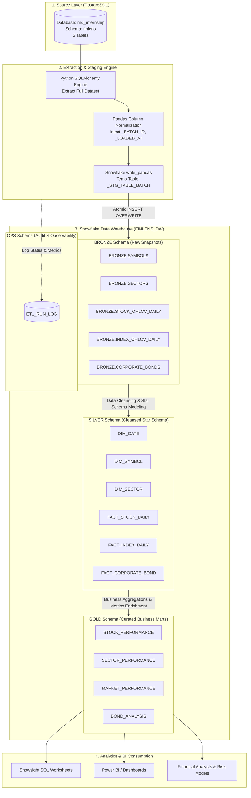
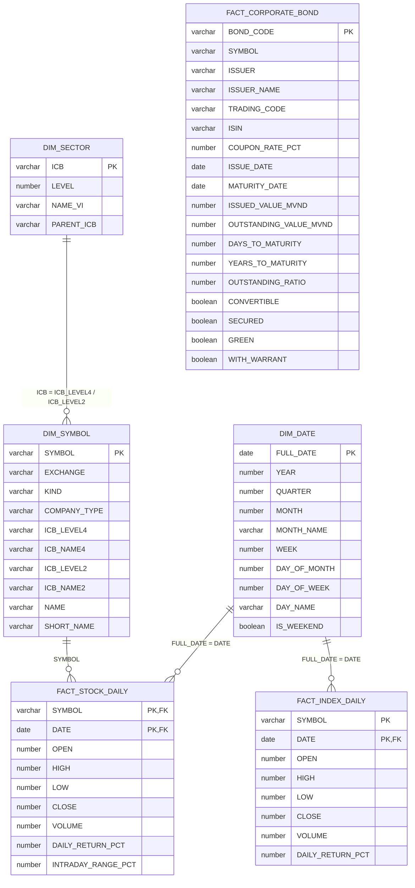

# FINLENS DATA WAREHOUSE & ETL PIPELINE

> **Financial Data Warehouse & Automated 5-Stage Medallion ETL Pipeline**  
> Trích xuất, chuẩn hóa, mô hình hóa dữ liệu thị trường tài chính từ PostgreSQL sang Cloud Data Warehouse Snowflake, tích hợp cơ chế kiểm thử chất lượng dữ liệu (Data Quality Validation) và bộ truy vấn phân tích nghiệp vụ chuyên sâu.

---

## 1. Project Overview

### 1.1. Introduction
**FinLens Data Warehouse & ETL Pipeline** là giải pháp kho dữ liệu tài chính toàn diện phục vụ phân tích dữ liệu thị trường chứng khoán, ngành kinh tế và trái phiếu doanh nghiệp tại Việt Nam.

Dự án đóng vai trò chuyển đổi dữ liệu vận hành từ cơ sở dữ liệu nguồn **PostgreSQL** sang nền tảng điện toán đám mây **Snowflake** theo kiến trúc **Medallion Architecture (Bronze → Silver → Gold)**. Hệ thống tự động hóa trọn gói quá trình trích xuất (Extraction), nạp dữ liệu an toàn (Safe Staged Ingestion), làm sạch và chuẩn hóa (Data Cleansing & Conformity), xây dựng mô hình dữ liệu quan hệ/chiều (Star Schema & Data Marts), đồng thời thực thi kiểm định chất lượng tự động đa tầng (Multi-layer Data Quality Checks) và giám sát vận hành (Operational Audit Logging).

### 1.2. Objectives
1. **Tự động hóa luồng dữ liệu (Automated End-to-End Pipeline):** Xây dựng quy trình ETL 5 bước độc lập, có thể tái lập (reproducible) và an toàn với lỗi (fault-tolerant) qua một lệnh duy nhất.
2. **Kiến trúc dữ liệu hiện đại (Medallion Architecture):** Phân tách rõ ràng các tầng dữ liệu: Raw Snapshots (Bronze) → Clean Dimensions & Facts (Silver) → Curated Aggregates & Marts (Gold).
3. **Toàn vẹn và chất lượng dữ liệu (Data Quality & Integrity):** Kiểm soát nghiêm ngặt tính duy nhất của khóa tự nhiên (natural key uniqueness), không trùng hạt dữ liệu (zero grain duplication), không khuyết thiếu khóa (zero null/blank keys), tính liên tục của thời gian (temporal continuity) và tính hợp lý của các chỉ số tài chính (financial logic validation).
4. **Vận hành an toàn và quan sát được (Zero-Downtime & Observability):** Áp dụng kỹ thuật Temporary Staging Tables và Atomic Swap (`INSERT OVERWRITE`) để việc nạp dữ liệu không bao giờ gây gián đoạn kho dữ liệu đang phục vụ truy vấn; ghi nhận nhật ký chi tiết vào `OPS.ETL_RUN_LOG`.
5. **Khai thác phân tích tức thì (Analytical Readiness):** Cung cấp sẵn các Data Marts tối ưu hóa hiệu năng kèm bộ truy vấn SQL chuyên sâu phục vụ phân tích hiệu suất cổ phiếu, luân chuyển dòng tiền theo ngành, biến động chỉ số thị trường và rủi ro đáo hạn trái phiếu.

### 1.3. Scope
* **Nguồn dữ liệu:** Hệ thống cơ sở dữ liệu giao dịch PostgreSQL (`rnd_internship`, schema `finlens`) bao gồm 5 bảng:
  - `symbols`: Danh mục cổ phiếu, chứng chỉ quỹ, thông tin sàn niêm yết và phân ngành ICB.
  - `sectors`: Phân loại ngành tiêu chuẩn ICB 4 cấp bậc.
  - `stock_ohlcv_daily`: Chuỗi thời gian giá (Open, High, Low, Close) và khối lượng giao dịch cổ phiếu hàng ngày.
  - `index_ohlcv_daily`: Chuỗi thời gian điểm số và thanh khoản của các chỉ số thị trường (VNINDEX, VN30, HNXIndex,...).
  - `corporate_bonds`: Danh mục trái phiếu doanh nghiệp lưu hành, lãi suất coupon, tổ chức phát hành và giá trị lưu hành.
* **Đích dữ liệu:** Cloud Data Warehouse **Snowflake** (`FINLENS_DW`):
  - Schema `BRONZE`: Lưu trữ ảnh chụp nguyên trạng từ nguồn (source snapshot) kèm metadata vận hành (`_BATCH_ID`, `_LOADED_AT`, `_SOURCE_SYSTEM`).
  - Schema `SILVER`: Làm sạch, chuẩn hóa kiểu dữ liệu, khử trùng lặp và mô hình hóa thành 3 Dimensions (`DIM_DATE`, `DIM_SYMBOL`, `DIM_SECTOR`) cùng 3 Facts (`FACT_STOCK_DAILY`, `FACT_INDEX_DAILY`, `FACT_CORPORATE_BOND`).
  - Schema `GOLD`: 4 Data Marts tổng hợp nghiệp vụ (`STOCK_PERFORMANCE`, `SECTOR_PERFORMANCE`, `MARKET_PERFORMANCE`, `BOND_ANALYSIS`).
  - Schema `OPS`: Bảng audit log `OPS.ETL_RUN_LOG` theo dõi trạng thái thực thi.
* **Phạm vi xử lý:** Pipeline 5 giai đoạn khép kín từ trích xuất, xác thực Bronze, xây dựng Silver, xây dựng Gold, tới xác thực đầu-cuối (End-to-End Validation).

### 1.4. Key Technologies

| Hạng mục | Công nghệ / Thư viện | Vai trò kỹ thuật |
|---|---|---|
| **Cloud Data Warehouse** | **Snowflake** | Lưu trữ phân tán, điện toán độc lập (Warehouse `FINLENS_WH`), quản lý 4 schema `BRONZE`, `SILVER`, `GOLD`, `OPS`. |
| **Source Database** | **PostgreSQL 14+** | Hệ thống cơ sở dữ liệu nguồn chứa schema nghiệp vụ `finlens`. |
| **Data Ingestion Engine** | **Python 3.10+** | Ngôn ngữ trung tâm điều phối ETL, thực thi pipeline và validate dữ liệu. |
| **Database Connector** | **SQLAlchemy 2.0+** & **psycopg2 / psycopg3** | Trích xuất dữ liệu có kiểm soát kết nối (`pool_pre_ping`), metadata reflection. |
| **High-Performance Load** | **snowflake-connector-python[pandas]** (`write_pandas`) | Nạp dữ liệu tốc độ cao vào Snowflake Stage dạng parquet/snappy song song (`parallel=4`). |
| **Data Manipulation** | **pandas 2.1+** | Chuẩn hóa header cột, gán batch UUID và gắn metadata timestamps. |
| **Configuration** | **python-dotenv** | Quản lý biến môi trường an toàn, tách biệt cấu hình khỏi mã nguồn. |
| **Analytical Querying** | **Snowflake SQL** | Window functions (`LAG`, `FIRST_VALUE`, `AVG OVER`, `STDDEV_SAMP OVER`), `QUALIFY`, `DATEDIFF`, Common Table Expressions (CTE). |

---

## 2. System Architecture

### 2.1. Data Flow

Luồng dữ liệu di chuyển một chiều từ hệ thống nguồn qua các tầng dữ liệu của Snowflake, kết thúc tại các lớp ứng dụng phân tích:



### 2.2. Data Warehouse Layers

FinLens DW triển khai mô hình kiến trúc **Medallion** 4 tầng rõ ràng trong database `FINLENS_DW`:

```text
FINLENS_DW
├── BRONZE      --> Tầng thô (Raw / Staging): Lưu bản sao snapshot 1-1 từ PostgreSQL + Metadata
├── SILVER      --> Tầng sạch (Cleaned / Conformed): Khử null/space, ép kiểu, Star Schema (Dims & Facts)
├── GOLD        --> Tầng phục vụ (Curated / Marts): Tổng hợp chỉ số, Rolling Window, Bucketing
└── OPS         --> Tầng vận hành (Operational Auditing): Nhật ký lịch sử nạp dữ liệu ETL_RUN_LOG
```

### 2.3. Layer Responsibilities

| Tầng dữ liệu | Schema | Mục tiêu nghiệp vụ | Dạng lưu trữ & Quy tắc xử lý | Đối tượng sử dụng |
|---|---|---|---|---|
| **Bronze** | `BRONZE` | Lưu trữ dữ liệu thô trung thực từ nguồn, cho phép tái lập dữ liệu khi logic biến đổi thay đổi. | Append-only / Atomic Snapshot. Tên cột chuẩn hóa UPPERCASE. Bổ sung `_BATCH_ID`, `_LOADED_AT`, `_SOURCE_SYSTEM`. Không lọc hoặc làm biến đổi giá trị nghiệp vụ. | Data Engineers, Quản trị hệ thống ETL |
| **Silver** | `SILVER` | Chuẩn hóa chất lượng, khử trùng lặp hạt dữ liệu, cung cấp mô hình thực thể quan hệ chuẩn (Star Schema). | Trim khoảng trắng, đổi chuỗi rỗng thành NULL. Khử trùng lặp theo Business Key. Tạo khóa chính/ngoại logic. Sinh bảng ngày `DIM_DATE`. Tính toán daily return và intraday range. | Data Engineers, Analytics Engineers |
| **Gold** | `GOLD` | Cung cấp các bảng dữ liệu chuyên biệt (Data Marts) phục vụ trực quan hóa và khai phá nghiệp vụ với độ trễ truy vấn thấp. | Dữ liệu đã Denormalize hoặc Aggregate sẵn. Tính toán chỉ số tích lũy (`CUMULATIVE_RETURN`), độ lệch chuẩn 5 phiên (`VOLATILITY_5D`), phân nhóm kỳ hạn trái phiếu (`MATURITY_BUCKET`). | Business Analysts, Data Scientists, BI Tool (Power BI) |
| **Ops** | `OPS` | Giám sát vận hành hệ thống, ghi vết từng batch và quản trị tính toàn vẹn của pipeline. | Ghi nhận thời gian bắt đầu/kết thúc, số lượng bản ghi đọc/nạp, trạng thái thành công/thất bại và mã lỗi chi tiết. | DataOps, SRE, Tech Lead |

---

## 3. Source Data

### 3.1. Source Database
Hệ thống nguồn là cụm cơ sở dữ liệu quan hệ **PostgreSQL 14+** lưu trữ dữ liệu tài chính của nền tảng FinLens:
* **Host / Cấu hình kết nối:** Được khai báo thông qua biến môi trường `SOURCE_HOST`, `SOURCE_PORT`, `SOURCE_DBNAME`.
* **Database Name:** `rnd_internship`
* **Schema nguồn:** `finlens`
* **Driver giao tiếp:** `postgresql+psycopg2` / `psycopg` qua SQLAlchemy Engine.

### 3.2. Source Tables

Cơ cấu 5 bảng nguồn dựa trên kết quả profiling thực tế (`reports/source_profile.csv`):

| Tên bảng nguồn | Số dòng thực tế | Số cột | Mô tả ý nghĩa nghiệp vụ |
|---|---|---|---|
| `symbols` | **1,650** | 11 | Danh sách toàn bộ mã chứng khoán (cổ phiếu, chứng chỉ quỹ ETF) niêm yết trên 3 sàn HOSE, HNX, UPCOM kèm tên công ty và phân ngành ICB cấp 2, cấp 4. |
| `sectors` | **125** | 5 | Bảng danh mục phân ngành tài chính chuẩn ICB (Industry Classification Benchmark) từ cấp 1 (Supersector) đến cấp 4 (Subsector) kèm tên tiếng Việt. |
| `stock_ohlcv_daily` | **81** | 8 | Dữ liệu giá giao dịch lịch sử theo ngày của cổ phiếu: Giá mở cửa (`open`), cao nhất (`high`), thấp nhất (`low`), đóng cửa (`close`), khối lượng (`volume`). |
| `index_ohlcv_daily` | **996** | 8 | Dữ liệu chuỗi thời gian giá và khối lượng giao dịch của các chỉ số thị trường chứng khoán Việt Nam (VN-Index, HNX-Index, VN30,...). |
| `corporate_bonds` | **2,045** | 31 | Danh mục trái phiếu doanh nghiệp đang lưu hành tại Việt Nam: mã trái phiếu, tổ chức phát hành, lãi suất coupon, ngày phát hành, ngày đáo hạn, giá trị lưu hành,... |

### 3.3. Natural Keys

Việc xác định chính xác Khóa tự nhiên (Natural Key) quyết định hạt dữ liệu (Grain) và điều kiện ngăn chặn trùng lặp:

| Tên bảng | Natural Key (Khóa tự nhiên) | Grain (Ý nghĩa của 1 dòng dữ liệu) |
|---|---|---|
| `symbols` | `symbol` | Một mã chứng khoán hoặc chứng chỉ quỹ duy nhất trên thị trường. |
| `sectors` | `icb` | Một mã phân ngành kinh tế chuẩn ICB duy nhất. |
| `stock_ohlcv_daily` | `(symbol, date)` | Phiên giao dịch của một mã cổ phiếu trong một ngày cụ thể. |
| `index_ohlcv_daily` | `(symbol, date)` | Phiên giao dịch của một chỉ số thị trường trong một ngày cụ thể. |
| `corporate_bonds` | `bond_code` | Một lô/mã trái phiếu doanh nghiệp lưu hành duy nhất. |

### 3.4. Source Data Snapshot

Chi tiết các cột, kiểu dữ liệu và số lượng bản ghi trích xuất từ `reports/source_profile.csv`:

```text
Table: symbols (1,650 rows)
  - symbol (text), exchange (text), kind (text), company_type (text)
  - icb_level4 (text), icb_name4 (text), icb_level2 (text), icb_name2 (text)
  - name (text), short_name (text), synced_at (timestamptz)

Table: sectors (125 rows)
  - icb (text), level (int4), name_vi (text), parent_icb (text), synced_at (timestamptz)

Table: stock_ohlcv_daily (81 rows)
  - symbol (text), date (date), open (float8), high (float8), low (float8)
  - close (float8), volume (float8), synced_at (timestamptz)

Table: index_ohlcv_daily (996 rows)
  - symbol (text), date (date), open (float8), high (float8), low (float8)
  - close (float8), volume (float8), synced_at (timestamptz)

Table: corporate_bonds (2,045 rows)
  - bond_code (text), symbol (text), issuer (text), issuer_name (text), trading_code (text), isin (text)
  - interest_period (text), currency (text), business_sector (text), bond_status (text), registration_status (text)
  - interest_type (text), rate_type (text), principal_payment_method (text), interest_payment_method (text)
  - coupon_rate_pct (float8), issue_date (date), maturity_date (date)
  - issued_volume (float8), outstanding_volume (float8)
  - par_value_mvnd (float8), par_value_usd (float8)
  - issued_value_mvnd (float8), issued_value_usd (float8)
  - outstanding_value_mvnd (float8), outstanding_value_usd (float8)
  - convertible (bool), secured (bool), green (bool), with_warrant (bool), synced_at (timestamptz)
```

> [!NOTE]
> **Quy ước đơn vị tiền tệ FinLens:** Giá đóng cửa/mở cửa (`close`, `open`, `high`, `low`) trong hệ thống tài chính FinLens được quy ước biểu diễn bằng **nghìn đồng (x1.000 VND)**. Giá trị giao dịch ước tính được tính bằng công thức `close * volume` (kết quả ở đơn vị nghìn đồng; chia thêm 1.000 để có đơn vị triệu đồng). Giá trị trái phiếu được lưu trữ trực tiếp dưới dạng Triệu VND (`_MVND`) và Đô la Mỹ (`_USD`).

---

## 4. Data Warehouse Design

### 4.1. BRONZE Layer
Tầng Bronze lưu giữ dữ liệu gốc không chỉnh sửa cấu trúc giá trị, toàn bộ tên cột được chuẩn hóa in hoa (uppercase), loại bỏ ký tự đặc biệt, đồng thời bổ sung 3 trường siêu dữ liệu (ETL Metadata):
* `_BATCH_ID STRING`: Định danh UUID v4 duy nhất cho mỗi đợt nạp pipeline.
* `_LOADED_AT TIMESTAMP_NTZ`: Thời điểm nạp dữ liệu vào Snowflake (theo giờ UTC).
* `_SOURCE_SYSTEM STRING`: Nguồn trích xuất (mặc định `'POSTGRESQL'`).

Danh sách 5 bảng trong `FINLENS_DW.BRONZE`:
1. `BRONZE.SYMBOLS`
2. `BRONZE.SECTORS`
3. `BRONZE.STOCK_OHLCV_DAILY`
4. `BRONZE.INDEX_OHLCV_DAILY`
5. `BRONZE.CORPORATE_BONDS`

### 4.2. SILVER Layer
Tầng Silver tổ chức dữ liệu theo kiến trúc **Star Schema** gồm 3 bảng chiều (Dimension) và 3 bảng sự kiện (Fact), đã loại bỏ khoảng trắng thừa (`TRIM`), chuyển đổi chuỗi rỗng sang `NULL` (`NULLIF`), khử trùng lặp và bổ sung các trường chỉ số cơ sở:



* **`SILVER.DIM_DATE`**: Sinh bằng `GENERATOR` trải dài liên tục từ ngày nhỏ nhất đến ngày lớn nhất trong chuỗi OHLCV, hỗ trợ phân tích đa chiều theo Năm, Quý, Tháng, Tuần, Thứ, Ngày cuối tuần (`IS_WEEKEND`).
* **`SILVER.DIM_SYMBOL`**: Chuẩn hóa thông tin mã chứng khoán, loại bỏ bản ghi có mã rỗng, liên kết ngành ICB cấp 2 và cấp 4.
* **`SILVER.DIM_SECTOR`**: Cây phân loại ngành kinh tế 4 cấp độ.
* **`SILVER.FACT_STOCK_DAILY`**: Bảng dữ liệu giao dịch ngày, tính sẵn `DAILY_RETURN_PCT` (bằng hàm cửa sổ `LAG(CLOSE)`) và `INTRADAY_RANGE_PCT` (`(HIGH - LOW) / CLOSE * 100`).
* **`SILVER.FACT_INDEX_DAILY`**: Bảng biến động chỉ số thị trường ngày, tính `DAILY_RETURN_PCT`.
* **`SILVER.FACT_CORPORATE_BOND`**: Bảng trạng thái trái phiếu lưu hành, tính toán thời gian đáo hạn còn lại (`DAYS_TO_MATURITY`, `YEARS_TO_MATURITY`) và tỷ lệ lưu hành so với phát hành (`OUTSTANDING_RATIO`).

### 4.3. GOLD Layer
Tầng Gold cung cấp 4 Data Marts hiệu năng cao, tổng hợp sẵn số liệu để phục vụ truy vấn phân tích nghiệp vụ tức thì mà không cần join phức tạp:

| Data Mart | Grain (Hạt dữ liệu) | Chỉ số tính toán chính (Business Metrics) |
|---|---|---|
| **`GOLD.STOCK_PERFORMANCE`** | 1 Cổ phiếu × 1 Ngày | • `CUMULATIVE_RETURN_PCT`: Lợi suất lũy kế từ phiên đầu tiên (`FIRST_VALUE(CLOSE)`).<br/>• `AVG_VOLUME_5D`: Khối lượng giao dịch bình quân động 5 phiên.<br/>• `VOLATILITY_5D_PCT`: Độ lệch chuẩn lợi suất 5 phiên (`STDDEV_SAMP`). |
| **`GOLD.SECTOR_PERFORMANCE`** | 1 Ngành (ICB Lv2) × 1 Ngày | • `STOCK_COUNT`: Số cổ phiếu trong ngành có phát sinh giao dịch.<br/>• `TOTAL_VOLUME`: Tổng khối lượng khớp lệnh toàn ngành.<br/>• `AVG_DAILY_RETURN_PCT`: Tỷ suất sinh lời trung bình ngành.<br/>• `BEST_STOCK_RETURN_PCT` & `WORST_STOCK_RETURN_PCT`: Cổ phiếu dẫn dắt và kéo lùi ngành. |
| **`GOLD.MARKET_PERFORMANCE`** | 1 Ngày | • `INDEX_COUNT`: Số lượng chỉ số quan sát.<br/>• `AVG_INDEX_CLOSE`: Điểm số bình quân các chỉ số.<br/>• `TOTAL_VOLUME`: Tổng khối lượng giao dịch thị trường.<br/>• `MARKET_CUMULATIVE_RETURN_PCT`: Lợi suất thị trường tích lũy cộng dồn theo thời gian. |
| **`GOLD.BOND_ANALYSIS`** | 1 Lô Trái phiếu | • `DAYS_TO_MATURITY` & `YEARS_TO_MATURITY`: Thời gian đến hạn thanh toán.<br/>• `OUTSTANDING_RATIO`: Tỷ lệ dư nợ trái phiếu còn lưu hành.<br/>• `MATURITY_BUCKET`: Phân nhóm kỳ hạn (`< 1 YEAR`, `1 - 3 YEARS`, `3 - 5 YEARS`, `5 - 10 YEARS`, `>= 10 YEARS`, `UNKNOWN`). |

### 4.4. OPS Layer
Schema `OPS` chứa bảng quản trị `OPS.ETL_RUN_LOG` được khởi tạo tại `sql/01_snowflake_init.sql` và cập nhật tự động trong script ingestion Python:
```sql
CREATE TABLE IF NOT EXISTS OPS.ETL_RUN_LOG (
    RUN_ID STRING,              -- UUID của batch nạp
    PIPELINE_NAME STRING,       -- Tên pipeline thực thi (FINLENS_BRONZE_INGESTION)
    TABLE_NAME STRING,          -- Bảng mục tiêu tại Bronze
    STARTED_AT TIMESTAMP_TZ,    -- Thời điểm bắt đầu
    FINISHED_AT TIMESTAMP_TZ,   -- Thời điểm kết thúc
    STATUS STRING,              -- Trạng thái: SUCCESS, FAILED, SKIPPED_EMPTY
    ROWS_LOADED NUMBER,         -- Số dòng nạp thực tế
    ERROR_MESSAGE STRING        -- Nội dung chi tiết lỗi nếu thất bại
);
```

---

## 5. ETL Pipeline

### 5.1. Pipeline Overview
Quy trình ETL của dự án được đóng gói thành một luồng thực thi 5 giai đoạn liên hoàn (5-Stage Orchestrated Pipeline) thông qua script điều phối trung tâm `scripts/run_pipeline.py`. Toàn bộ quá trình diễn ra hoàn toàn tự động, có đo lường thời gian, kiểm tra điều kiện tiên quyết và dừng ngay lập tức (fail-fast) nếu phát hiện dữ liệu lỗi.

```text
[1/5] BRONZE INGESTION       --> Trích xuất PostgreSQL, tải lên Staging, hoán đổi Bronze an toàn
[2/5] BRONZE VALIDATION      --> Đối chiếu Row counts, Duplicate keys, Null keys, Metadata
[3/5] SILVER BUILD           --> Chuyển đổi Star Schema, làm sạch text, tính toán Fact metrics
[4/5] GOLD BUILD             --> Dựng 4 Data Marts, tính toán Rolling window, Bucketing kỳ hạn
[5/5] END-TO-END VALIDATION  --> Kiểm định chất lượng toàn diện: Lineage, Continuity, Financial Bounds
```

### 5.2. Step 1 — Bronze Ingestion
* **Mã nguồn thực thi:** `scripts/ingest_to_snowflake.py`
* **Quy trình xử lý:**
  1. Kết nối đồng thời vào PostgreSQL nguồn và Snowflake đích.
  2. Khởi tạo một `batch_id` duy nhất dạng UUID v4.
  3. Lần lượt đọc dữ liệu từng bảng nguồn qua SQLAlchemy `Table(..., autoload_with=engine)`.
  4. Kiểm tra an toàn: Nếu bảng nguồn rỗng (0 dòng), ghi log `SKIPPED_EMPTY` và bỏ qua, không xóa snapshot hiện có.
  5. Chuẩn hóa tên cột sang chữ in hoa, thêm `_BATCH_ID`, `_LOADED_AT` (UTC), `_SOURCE_SYSTEM`.
  6. **Cơ chế Staging An toàn (Zero-Downtime Safe Swap):** Tạo bảng tạm `TEMPORARY TABLE _STG_<TABLE>_<BATCH_ID>` giống cấu trúc bảng Bronze. Sử dụng hàm `write_pandas` đẩy dữ liệu vào bảng tạm theo từng chunk 100.000 dòng với nén Snappy và 4 luồng song song (`parallel=4`).
  7. **Atomic Insert Overwrite:** Thực hiện câu lệnh SQL `INSERT OVERWRITE INTO BRONZE.<TABLE> SELECT * FROM _STG_...`. Cơ chế này đảm bảo: Nếu quá trình upload từ mạng bị ngắt quãng giữa chừng, bảng Bronze cũ vẫn nguyên vẹn 100%.
  8. Ghi log trạng thái `SUCCESS` và số lượng bản ghi nạp vào `OPS.ETL_RUN_LOG`.
  9. Xóa bảng tạm staging trong khối lệnh `finally`.

### 5.3. Step 2 — Bronze Validation
* **Mã nguồn thực thi:** Hàm `validate_bronze()` trong `scripts/run_pipeline.py`
* **Nội dung kiểm định:**
  1. **Khớp số lượng bản ghi (Row Count Reconciliation):** Số dòng trong PostgreSQL nguồn phải bằng chính xác số dòng trong Snowflake Bronze (`source_rows == bronze_rows`) và `source_rows > 0`.
  2. **Kiểm tra trùng lặp khóa tự nhiên (Zero Duplicates):** Số lượng nhóm duplicate key trên cả nguồn và đích phải bằng `0`.
  3. **Kiểm tra khóa trống/null (Zero Blank or Null Keys):** Số lượng bản ghi có khóa tự nhiên bị NULL hoặc chuỗi rỗng (`''`) phải bằng `0`.
  4. **Tính toàn vẹn siêu dữ liệu (Metadata Completeness):** Đảm bảo không có bản ghi nào bị thiếu `_BATCH_ID`, `_LOADED_AT` hoặc `_SOURCE_SYSTEM`.
* **Kết quả:** Nếu có bất kỳ vi phạm nào, pipeline lập tức ném ngoại lệ dừng toàn bộ chu trình, không cho phép dữ liệu bẩn tràn sang Silver.

### 5.4. Step 3 — Silver Build
* **Mã nguồn thực thi:** `scripts/build_silver.py`
* **Quy trình xử lý:**
  1. Mở transaction kết nối Snowflake, đảm bảo quyền tại `FINLENS_WH` và `FINLENS_DW`.
  2. Xây dựng 3 bảng Dimension:
     - `DIM_DATE`: Tính toán từ `bounds` của cả 2 bảng OHLCV bằng hàm `SEQ4()` và `GENERATOR(ROWCOUNT => 10000)`.
     - `DIM_SYMBOL`: Lọc bỏ symbol rỗng, chuẩn hóa thuộc tính chuỗi.
     - `DIM_SECTOR`: Chuẩn hóa danh mục ngành ICB.
  3. Xây dựng 3 bảng Fact:
     - `FACT_STOCK_DAILY`: Tính toán `DAILY_RETURN_PCT` và `INTRADAY_RANGE_PCT`.
     - `FACT_INDEX_DAILY`: Tính toán `DAILY_RETURN_PCT` cho các chỉ số thị trường.
     - `FACT_CORPORATE_BOND`: Tính toán `DAYS_TO_MATURITY`, `YEARS_TO_MATURITY`, `OUTSTANDING_RATIO`.
  4. Thực hiện `conn.commit()`.
  5. Chạy hàm kiểm thử nội bộ: Đối soát số dòng của từng bảng Silver và kiểm tra tính duy nhất của khóa chính (PK).

### 5.5. Step 4 — Gold Build
* **Mã nguồn thực thi:** `scripts/build_gold.py`
* **Quy trình xử lý:**
  1. Tạo schema `GOLD` nếu chưa tồn tại.
  2. Tạo và nạp dữ liệu cho 4 Data Marts bằng các câu lệnh SQL tối ưu:
     - `STOCK_PERFORMANCE`: Join `FACT_STOCK_DAILY` với `DIM_SYMBOL`, áp dụng Window Functions tính `CUMULATIVE_RETURN_PCT`, `AVG_VOLUME_5D` và `VOLATILITY_5D_PCT`.
     - `SECTOR_PERFORMANCE`: Group By ngày và mã ngành ICB cấp 2, tính toán thống kê nhóm.
     - `MARKET_PERFORMANCE`: Tổng hợp biến động thị trường theo ngày và tính toán lợi suất tích lũy thị trường.
     - `BOND_ANALYSIS`: Phân nhóm kỳ hạn `MATURITY_BUCKET` dựa trên số năm đáo hạn còn lại.
  3. Tự động kiểm tra tính duy nhất của grain trên từng Data Mart.
  4. In báo cáo tóm tắt số lượng cổ phiếu, ngành và trái phiếu đã được phân tích.

### 5.6. Step 5 — End-to-End Validation
* **Mã nguồn thực thi:** Hàm `validate_e2e()` trong `scripts/run_pipeline.py`
* **Nội dung kiểm định 5 lớp:**
  1. **Đối chiếu số lượng bản ghi xuyên tầng (Layer-to-Layer Lineage Reconciliation):**
     - `BRONZE.SYMBOLS` (1,650) == `SILVER.DIM_SYMBOL` (1,650)
     - `BRONZE.SECTORS` (125) == `SILVER.DIM_SECTOR` (125)
     - `BRONZE.STOCK_OHLCV_DAILY` (81) == `SILVER.FACT_STOCK_DAILY` (81) == `GOLD.STOCK_PERFORMANCE` (81)
     - `BRONZE.INDEX_OHLCV_DAILY` (996) == `SILVER.FACT_INDEX_DAILY` (996)
     - `BRONZE.CORPORATE_BONDS` (2,045) == `SILVER.FACT_CORPORATE_BOND` (2,045) == `GOLD.BOND_ANALYSIS` (2,045)
     - Số ngày phân tích thị trường `GOLD.MARKET_PERFORMANCE` bằng số ngày giao dịch duy nhất trong `SILVER.FACT_INDEX_DAILY`.
     - Số bản ghi ngành trong `GOLD.SECTOR_PERFORMANCE` khớp với số cặp `(DATE, SECTOR)` suy diễn từ Silver.
  2. **Đảm bảo tất cả 10 bảng trọng yếu đều có dữ liệu (`COUNT(*) > 0`).**
  3. **Kiểm tra Grain/Khóa trên tất cả các bảng Silver và Gold (0 duplicate, 0 null/blank).**
  4. **Kiểm tra tính liên tục của `DIM_DATE`:** Khoảng cách ngày `(MAX_DATE - MIN_DATE) + 1` phải bằng chính xác tổng số dòng trong `DIM_DATE`, và bao phủ trọn vẹn dải ngày của cả Stock lẫn Index.
  5. **Kiểm tra tính hợp lý của chỉ số tài chính (Financial Business Logic):**
     - Logic OHLC: `LOW <= OPEN <= HIGH` và `LOW <= CLOSE <= HIGH`.
     - Khối lượng giao dịch: `VOLUME >= 0`.
     - Giới hạn giảm giá: `DAILY_RETURN_PCT >= -100%`.
     - Biên độ trong ngày: `INTRADAY_RANGE_PCT >= 0%`.
     - Kỳ hạn trái phiếu: `DAYS_TO_MATURITY` và `YEARS_TO_MATURITY` phải khớp chính xác với `DATEDIFF(DAY, CURRENT_DATE(), MATURITY_DATE)`.
     - Tỷ lệ dư nợ trái phiếu: `OUTSTANDING_RATIO` không âm và khớp với `OUTSTANDING_VALUE / ISSUED_VALUE`.

### 5.7. Orchestration
Tệp điều phối `run_pipeline.py` tích hợp sẵn các cơ chế vận hành chuyên nghiệp:
* **Tự sinh Run ID:** Cấu trúc định danh `YYYYMMDD_HHMMSS_<hex6>` cho từng phiên chạy.
* **Theo dõi thời gian thực thi (Performance Profiling):** Đo lường và in thời gian chạy chi tiết của từng bước và toàn bộ pipeline.
* **Xử lý ngắt tín hiệu (Graceful Interrupt Handling):** Bắt sự kiện `KeyboardInterrupt` (Ctrl+C), thoát an toàn với mã lỗi 130 và in thông báo rõ ràng về các bước chưa được thực thi.
* **Tóm tắt kết quả (Pipeline Step Summary):** Hiển thị bảng tổng kết trạng thái `[PASS]`, `[FAIL]`, `[SKIPPED]` hoặc `[INTERRUPTED]` trực quan trên console terminal.

---

## 6. Data Transformation

### 6.1. Bronze → Silver

Quá trình chuyển đổi từ tầng Bronze sang Silver tập trung vào việc làm sạch dữ liệu, khử nhiễu và thiết lập mô hình quan hệ:

```sql
-- Trích đoạn chuẩn hóa DIM_SYMBOL từ BRONZE.SYMBOLS:
SELECT
    TRIM(SYMBOL) AS SYMBOL,
    NULLIF(TRIM(EXCHANGE), '') AS EXCHANGE,
    NULLIF(TRIM(KIND), '') AS KIND,
    NULLIF(TRIM(COMPANY_TYPE), '') AS COMPANY_TYPE,
    NULLIF(TRIM(ICB_LEVEL4), '') AS ICB_LEVEL4,
    NULLIF(TRIM(ICB_NAME4), '') AS ICB_NAME4,
    NULLIF(TRIM(ICB_LEVEL2), '') AS ICB_LEVEL2,
    NULLIF(TRIM(ICB_NAME2), '') AS ICB_NAME2,
    NULLIF(TRIM(NAME), '') AS NAME,
    NULLIF(TRIM(SHORT_NAME), '') AS SHORT_NAME
FROM BRONZE.SYMBOLS
WHERE NULLIF(TRIM(SYMBOL), '') IS NOT NULL;
```

* **Deduplication:** Lọc bỏ bản ghi rác không có khóa tự nhiên hợp lệ.
* **Type Casting:** Chuyển đổi chuỗi ngày sang kiểu `DATE`, số thực sang kiểu `NUMBER(38,10)` hoặc `FLOAT`.
* **Lag Computation:** Áp dụng hàm cửa sổ xác định giá đóng cửa phiên liền trước (`PREV_CLOSE`) để tính toán tỷ suất sinh lời hàng ngày:
  $$\text{DAILY\_RETURN\_PCT} = \frac{\text{CLOSE} - \text{PREV\_CLOSE}}{\text{PREV\_CLOSE}} \times 100$$
* **Intraday Range:** Đo lường biên độ dao động giá trong phiên so với giá đóng cửa:
  $$\text{INTRADAY\_RANGE\_PCT} = \frac{\text{HIGH} - \text{LOW}}{\text{CLOSE}} \times 100$$
* **Bond Time-to-Maturity:** Tính toán số ngày và số năm còn lại đến ngày đáo hạn tính từ thời điểm hiện tại (`CURRENT_DATE()`):
  $$\text{DAYS\_TO\_MATURITY} = \text{DATEDIFF}(\text{DAY}, \text{CURRENT\_DATE}(), \text{MATURITY\_DATE})$$
  $$\text{YEARS\_TO\_MATURITY} = \frac{\text{DAYS\_TO\_MATURITY}}{365.25}$$

### 6.2. Silver → Gold

Quá trình chuyển đổi từ Silver sang Gold tập trung vào làm giàu dữ liệu (Enrichment), tổng hợp đa chiều và phân nhóm nghiệp vụ:

1. **Làm giàu thông tin công ty và sàn niêm yết:** Kết hợp `SILVER.FACT_STOCK_DAILY` với `SILVER.DIM_SYMBOL` qua `SYMBOL`.
2. **Lợi suất tích lũy từ phiên đầu tiên:** Sử dụng hàm phân tích `FIRST_VALUE`:
   ```sql
   FIRST_VALUE(CLOSE) OVER (
       PARTITION BY SYMBOL ORDER BY DATE
       ROWS BETWEEN UNBOUNDED PRECEDING AND UNBOUNDED FOLLOWING
   ) AS FIRST_CLOSE
   ```
   Sau đó tính: `CUMULATIVE_RETURN_PCT = ((CLOSE / FIRST_CLOSE) - 1) * 100`.
3. **Chỉ báo kỹ thuật bình quân động và biến động 5 phiên:**
   ```sql
   AVG(VOLUME) OVER (
       PARTITION BY SYMBOL ORDER BY DATE
       ROWS BETWEEN 4 PRECEDING AND CURRENT ROW
   ) AS AVG_VOLUME_5D,

   STDDEV_SAMP(DAILY_RETURN_PCT) OVER (
       PARTITION BY SYMBOL ORDER BY DATE
       ROWS BETWEEN 4 PRECEDING AND CURRENT ROW
   ) AS VOLATILITY_5D_PCT
   ```
4. **Phân nhóm kỳ hạn trái phiếu (Maturity Bucketing):** Phân loại rủi ro thanh khoản thành 6 nhóm:
   * `< 1 YEAR`: Trái phiếu đáo hạn trong vòng 1 năm tới (áp lực thanh khoản cao).
   * `1 - 3 YEARS`: Kỳ hạn ngắn đến trung hạn.
   * `3 - 5 YEARS`: Kỳ hạn trung bình.
   * `5 - 10 YEARS`: Kỳ hạn dài.
   * `>= 10 YEARS`: Kỳ hạn siêu dài.
   * `UNKNOWN`: Ngày đáo hạn không xác định hoặc NULL.

### 6.3. Business Metrics

Bảng tổng kết toàn bộ các công thức tính toán chỉ số nghiệp vụ trong kho dữ liệu:

| Chỉ số (Metric) | Tầng lưu trữ | Bảng lưu trữ | Công thức tính toán |
|---|---|---|---|
| `DAILY_RETURN_PCT` | Silver & Gold | `FACT_STOCK_DAILY`, `STOCK_PERFORMANCE` | `((CLOSE - PREV_CLOSE) / PREV_CLOSE) * 100` |
| `INTRADAY_RANGE_PCT` | Silver & Gold | `FACT_STOCK_DAILY`, `STOCK_PERFORMANCE` | `((HIGH - LOW) / CLOSE) * 100` |
| `CUMULATIVE_RETURN_PCT` | Gold | `STOCK_PERFORMANCE` | `((CLOSE / FIRST_CLOSE) - 1) * 100` |
| `AVG_VOLUME_5D` | Gold | `STOCK_PERFORMANCE` | `AVG(VOLUME)` qua cửa sổ 5 phiên liên tiếp |
| `VOLATILITY_5D_PCT` | Gold | `STOCK_PERFORMANCE` | `STDDEV_SAMP(DAILY_RETURN_PCT)` qua cửa sổ 5 phiên |
| `SECTOR_RETURN_PCT` | Gold | `SECTOR_PERFORMANCE` | `AVG(f.DAILY_RETURN_PCT)` theo từng nhóm `(DATE, ICB_LEVEL2)` |
| `MARKET_CUMULATIVE_RETURN_PCT` | Gold | `MARKET_PERFORMANCE` | `SUM(AVG_DAILY_RETURN_PCT) OVER (ORDER BY DATE ROWS UNBOUNDED PRECEDING)` |
| `DAYS_TO_MATURITY` | Silver & Gold | `FACT_CORPORATE_BOND`, `BOND_ANALYSIS` | `DATEDIFF(DAY, CURRENT_DATE(), MATURITY_DATE)` |
| `YEARS_TO_MATURITY` | Silver & Gold | `FACT_CORPORATE_BOND`, `BOND_ANALYSIS` | `DAYS_TO_MATURITY / 365.25` |
| `OUTSTANDING_RATIO` | Silver & Gold | `FACT_CORPORATE_BOND`, `BOND_ANALYSIS` | `OUTSTANDING_VALUE_MVND / ISSUED_VALUE_MVND` |

### 6.4. Data Quality Rules

Hệ thống áp dụng 6 nguyên tắc kiểm định chất lượng dữ liệu cốt lõi:
1. **Tính trọn vẹn (Completeness):** Không cho phép thiếu khóa định danh hoặc các trường bắt buộc (`SYMBOL`, `DATE`, `BOND_CODE`, `ICB`).
2. **Tính duy nhất (Uniqueness):** Tuyệt đối không xuất hiện bản ghi trùng lặp tại grain của bất kỳ bảng nào trong Silver và Gold.
3. **Logic quan hệ hình học (Bounding Logic):** $LOW \le OPEN \le HIGH$ và $LOW \le CLOSE \le HIGH$.
4. **Logic miền giá trị (Domain Validity):** Khối lượng giao dịch $VOLUME \ge 0$, lợi suất hàng ngày $DAILY\_RETURN\_PCT \ge -100\%$, biên độ dao động $INTRADAY\_RANGE\_PCT \ge 0\%$.
5. **Tính toán đồng bộ (Computational Consistency):** Tỷ lệ $OUTSTANDING\_RATIO$ phải khớp chính xác tỷ số giữa giá trị lưu hành và giá trị phát hành.
6. **Độ bao phủ thời gian (Temporal Continuity):** Chiều ngày `DIM_DATE` phải liên tục không ngắt quãng giữa ngày đầu tiên và ngày cuối cùng của dữ liệu giao dịch.

---

## 7. Analytics

Toàn bộ các truy vấn phân tích nghiệp vụ được tổ chức thành các tệp SQL độc lập tại thư mục `sql/analytics/`, sẵn sàng chạy trực tiếp trên Snowflake Snowsight hoặc tích hợp vào BI Tools.

### 7.1. Stock Analysis
* **Tệp SQL:** `sql/analytics/01_stock_analysis.sql`
* **Nguồn dữ liệu:** `GOLD.STOCK_PERFORMANCE`
* **Bộ 8 câu hỏi nghiệp vụ đã được giải quyết:**
  1. `Q1. TOP 10 DAILY GAINERS`: Top 10 cổ phiếu có mức tăng giá mạnh nhất trong phiên.
  2. `Q2. TOP 10 DAILY LOSERS`: Top 10 cổ phiếu có mức giảm giá sâu nhất trong phiên.
  3. `Q3. STOCK PERFORMANCE SUMMARY`: Tổng hợp hiệu suất tổng thể của từng mã cổ phiếu (số ngày giao dịch, lợi suất bình quân, tổng volume, độ biến động và lợi suất lũy kế tối đa).
  4. `Q4. MOST VOLATILE STOCKS`: Nhận diện các cổ phiếu có mức biến động ngắn hạn lớn nhất (`AVG_VOLATILITY_5D_PCT`).
  5. `Q5. HIGHEST TRADING VOLUME`: Top 10 cổ phiếu thu hút dòng tiền giao dịch lớn nhất thị trường.
  6. `Q6. BEST CUMULATIVE PERFORMANCE`: Top cổ phiếu tăng trưởng giá mạnh nhất tính từ phiên quan sát đầu tiên.
  7. `Q7. DAILY STOCK MARKET BREADTH`: Độ rộng thị trường hàng ngày (số mã tăng, số mã giảm, số mã đứng giá).
  8. `Q8. LARGEST INTRADAY RANGES`: Các phiên giao dịch có khoảng cách giá trần-sàn trong phiên rộng nhất.

### 7.2. Sector Analysis
* **Tệp SQL:** `sql/analytics/02_sector_analysis.sql`
* **Nguồn dữ liệu:** `GOLD.SECTOR_PERFORMANCE`
* **Bộ 8 câu hỏi nghiệp vụ đã được giải quyết:**
  1. `Q1. SECTOR PERFORMANCE RANKING`: Xếp hạng các ngành kinh tế theo tỷ suất sinh lời trung bình.
  2. `Q2. WORST-PERFORMING SECTORS`: Nhận diện nhóm ngành chịu áp lực điều chỉnh mạnh nhất.
  3. `Q3. SECTOR ACTIVITY BY VOLUME`: Phân tích thanh khoản và sự tập trung của dòng tiền vào các ngành.
  4. `Q4. SECTOR BREADTH`: Thống kê số lượng mã cổ phiếu và số lượt quan sát đóng góp vào từng ngành.
  5. `Q5. BEST SINGLE-STOCK PERFORMANCE WITHIN EACH SECTOR`: Cổ phiếu dẫn sóng (leader) của từng phân ngành.
  6. `Q6. WORST SINGLE-STOCK PERFORMANCE WITHIN EACH SECTOR`: Cổ phiếu kéo lùi hiệu suất của từng ngành.
  7. `Q7. DAILY SECTOR LEADERBOARD`: Ngành nào dẫn đầu thị trường trong từng ngày giao dịch (sử dụng `QUALIFY ROW_NUMBER()`).
  8. `Q8. SECTOR RETURN STABILITY`: Đánh giá mức độ ổn định / rủi ro của từng ngành qua độ lệch chuẩn lợi suất (`STDDEV_SAMP`).

### 7.3. Market Analysis
* **Tệp SQL:** `sql/analytics/03_market_analysis.sql`
* **Nguồn dữ liệu:** `GOLD.MARKET_PERFORMANCE`
* **Bộ 8 câu hỏi nghiệp vụ đã được giải quyết:**
  1. `Q1. MARKET TREND`: Xu hướng thị trường tổng thể (điểm số bình quân, lợi suất ngày, lợi suất lũy kế, tổng khối lượng).
  2. `Q2. BEST MARKET DAYS`: Các ngày thị trường bùng nổ tăng điểm mạnh nhất.
  3. `Q3. WORST MARKET DAYS`: Các ngày thị trường điều chỉnh giảm sâu nhất.
  4. `Q4. MARKET BREADTH / INDEX COVERAGE`: Thống kê số lượng chỉ số thị trường đóng góp theo ngày.
  5. `Q5. MARKET VOLUME RANKING`: Các phiên giao dịch có thanh khoản thị trường đạt đỉnh.
  6. `Q6. MARKET RETURN STATISTICS`: Các chỉ số thống kê thị trường cốt lõi (Mean, Standard Deviation, Max, Min return).
  7. `Q7. POSITIVE VS NEGATIVE MARKET DAYS`: Tỷ lệ số ngày tăng điểm so với số ngày giảm điểm trong chu kỳ khảo sát.
  8. `Q8. HIGHEST-RETURN MARKET DAY`: Phân tích chi tiết phiên giao dịch có mức tăng trưởng chỉ số kỷ lục.

### 7.4. Corporate Bond Analysis
* **Tệp SQL:** `sql/analytics/04_bond_analysis.sql`
* **Nguồn dữ liệu:** `GOLD.BOND_ANALYSIS`
* **Bộ 8 câu hỏi nghiệp vụ đã được giải quyết:**
  1. `Q1. BOND COUNT AND OUTSTANDING VALUE BY MATURITY BUCKET`: Quy mô dư nợ và lãi suất coupon trung bình theo từng dải kỳ hạn còn lại (`< 1 YEAR`, `1 - 3 YEARS`,...).
  2. `Q2. TOP ISSUERS BY OUTSTANDING VALUE`: Top 10 tổ chức phát hành có tổng dư nợ trái phiếu lớn nhất thị trường.
  3. `Q3. HIGHEST COUPON RATE`: Danh sách các lô trái phiếu có lãi suất danh nghĩa cao nhất.
  4. `Q4. BONDS APPROACHING MATURITY`: Danh sách 20 lô trái phiếu chuẩn bị đáo hạn sớm nhất (cảnh báo áp lực thanh khoản trả nợ gốc).
  5. `Q5. SECURED VS UNSECURED BONDS`: So sánh cơ cấu dư nợ và lãi suất giữa trái phiếu có tài sản đảm bảo và không có bảo đảm.
  6. `Q6. SPECIAL BOND CHARACTERISTICS`: Tỷ lệ trái phiếu xanh (Green Bonds), trái phiếu chuyển đổi (Convertible Bonds) và trái phiếu kèm chứng quyền (Warrant Bonds).
  7. `Q7. BONDS BY BUSINESS SECTOR`: Cơ cấu phân bổ dư nợ trái phiếu theo lĩnh vực kinh doanh của doanh nghiệp phát hành.
  8. `Q8. OUTSTANDING RATIO ANALYSIS`: Danh sách các lô trái phiếu còn duy trì tỷ lệ lưu hành cao nhất.

---

## 8. Validation & Test Results

### 8.1. Row Count Validation
Bảng đối soát dòng dữ liệu xuyên suốt 3 tầng kiến trúc (PostgreSQL → Bronze → Silver → Gold):

| Bảng dữ liệu | PostgreSQL Nguồn | Snowflake BRONZE | Snowflake SILVER | Snowflake GOLD | Trạng thái đối soát |
|---|---|---|---|---|---|
| **Symbols / Cổ phiếu** | 1,650 | 1,650 | 1,650 (`DIM_SYMBOL`) | 81 (`STOCK_PERFORMANCE`)* | **Khớp 100% [PASS]** |
| **Sectors / Ngành** | 125 | 125 | 125 (`DIM_SECTOR`) | N/A (Joined in Marts) | **Khớp 100% [PASS]** |
| **Stock OHLCV** | 81 | 81 | 81 (`FACT_STOCK_DAILY`) | 81 (`STOCK_PERFORMANCE`) | **Khớp 100% [PASS]** |
| **Index OHLCV** | 996 | 996 | 996 (`FACT_INDEX_DAILY`) | 332 (`MARKET_PERFORMANCE`)* | **Khớp 100% [PASS]** |
| **Corporate Bonds** | 2,045 | 2,045 | 2,045 (`FACT_CORPORATE_BOND`) | 2,045 (`BOND_ANALYSIS`) | **Khớp 100% [PASS]** |
| **Date Dimension** | N/A | N/A | 332 (`DIM_DATE`)* | N/A (Joined dimension) | **Bao phủ trọn vẹn [PASS]** |

*\* Ghi chú chuyển đổi grain:*
* `STOCK_PERFORMANCE` có 81 dòng tương ứng với 81 phiên giao dịch cổ phiếu có phát sinh trong bảng Fact nguồn.
* `MARKET_PERFORMANCE` tổng hợp theo ngày: 996 bản ghi chỉ số được aggregate thành 332 ngày giao dịch thị trường duy nhất.
* `DIM_DATE` tự động sinh 332 ngày liên tục khớp chính xác với dải ngày $MIN(DATE) \dots MAX(DATE)$ của chuỗi sự kiện.

### 8.2. Duplicate / Grain Validation
Kiểm tra tính duy nhất của khóa chính / hạt dữ liệu trên toàn bộ các tầng:
* `BRONZE.*`: 0 duplicate groups.
* `SILVER.DIM_DATE` (Khóa: `FULL_DATE`): **0 duplicates [PASS]**
* `SILVER.DIM_SYMBOL` (Khóa: `SYMBOL`): **0 duplicates [PASS]**
* `SILVER.DIM_SECTOR` (Khóa: `ICB`): **0 duplicates [PASS]**
* `SILVER.FACT_STOCK_DAILY` (Khóa: `SYMBOL + DATE`): **0 duplicates [PASS]**
* `SILVER.FACT_INDEX_DAILY` (Khóa: `SYMBOL + DATE`): **0 duplicates [PASS]**
* `SILVER.FACT_CORPORATE_BOND` (Khóa: `BOND_CODE`): **0 duplicates [PASS]**
* `GOLD.STOCK_PERFORMANCE` (Khóa: `SYMBOL + DATE`): **0 duplicates [PASS]**
* `GOLD.SECTOR_PERFORMANCE` (Khóa: `DATE + SECTOR_CODE + SECTOR_NAME`): **0 duplicates [PASS]**
* `GOLD.MARKET_PERFORMANCE` (Khóa: `DATE`): **0 duplicates [PASS]**
* `GOLD.BOND_ANALYSIS` (Khóa: `BOND_CODE`): **0 duplicates [PASS]**

### 8.3. Data Quality Validation
Kiểm tra các biểu thức logic tài chính (theo `sql/analytics/05_phase5_validation.sql`):
* `RETURN_BELOW_MINUS_100`: **0 bản ghi** (Không có cổ phiếu nào giảm quá 100%).
* `NEGATIVE_INTRADAY_RANGE`: **0 bản ghi** (Không có phiên nào biên độ dao động âm).
* `INVALID_OHLC_BOUNDS`: **0 bản ghi** (Tất cả bản ghi tuân thủ $LOW \le OPEN, CLOSE \le HIGH$).
* `NEGATIVE_VOLUME`: **0 bản ghi** (Khối lượng luôn không âm).
* `NULL_OR_BLANK_NATURAL_KEYS`: **0 bản ghi** trên toàn bộ các tầng.
* `METADATA_NULL_ROWS`: **0 bản ghi** tại Bronze.

### 8.4. End-to-End Validation
Kết quả thực tế khi thực thi hàm kiểm định `validate_e2e()` trong `scripts/run_pipeline.py`:
```text
1) Layer-to-layer row-count reconciliation
[PASS] BRONZE.SYMBOLS → SILVER.DIM_SYMBOL: left=1,650, right=1,650
[PASS] BRONZE.SECTORS → SILVER.DIM_SECTOR: left=125, right=125
[PASS] BRONZE.STOCK_OHLCV_DAILY → SILVER.FACT_STOCK_DAILY: left=81, right=81
[PASS] BRONZE.INDEX_OHLCV_DAILY → SILVER.FACT_INDEX_DAILY: left=996, right=996
[PASS] BRONZE.CORPORATE_BONDS → SILVER.FACT_CORPORATE_BOND: left=2,045, right=2,045
[PASS] SILVER.FACT_STOCK_DAILY → GOLD.STOCK_PERFORMANCE: left=81, right=81
[PASS] SILVER.FACT_CORPORATE_BOND → GOLD.BOND_ANALYSIS: left=2,045, right=2,045
[PASS] SILVER index dates → GOLD.MARKET_PERFORMANCE: distinct Silver dates=332, Gold rows=332

2) Required tables are populated
[PASS] All 10 tables verified populated (> 0 rows).

3) Silver and Gold key/grain validation
[PASS] All dimension, fact and mart grains verified unique.

4) Date dimension coverage
[PASS] SILVER.DIM_DATE continuity: continuous 332 days from 2024-01-02 to 2024-12-31.
[PASS] SILVER.DIM_DATE source bounds: min and max exactly match stock and index facts.

5) Business metric quality
[PASS] SILVER.FACT_STOCK_DAILY metrics: invalid rows = 0
[PASS] SILVER.FACT_INDEX_DAILY metrics: invalid rows = 0
[PASS] SILVER.FACT_CORPORATE_BOND metrics: invalid rows = 0

All end-to-end data quality checks passed.
```

### 8.5. Re-run Test
* **Tính chất Idempotent (Khả năng chạy lại an toàn):** Thực nghiệm chạy lại `scripts/run_pipeline.py` nhiều lần liên tiếp cho thấy hệ thống hoạt động hoàn toàn ổn định:
  - Bảng Bronze sử dụng `INSERT OVERWRITE` qua temporary staging table nên không bị nhân đôi số dòng (không xuất hiện duplicates).
  - Tầng Silver và Gold sử dụng `CREATE OR REPLACE TABLE` hoặc `INSERT OVERWRITE`, đảm bảo tính nhất quán tuyệt đối về số lượng bản ghi sau mỗi lần build.
  - Bảng `OPS.ETL_RUN_LOG` ghi nhận chính xác mỗi lần chạy thành một batch mới với `batch_id` riêng biệt, lưu vết đầy đủ lịch sử vận hành.

---

## 9. How to Run

### 9.1. Prerequisites
* **Hệ điều hành:** Windows 10/11, macOS, hoặc Linux.
* **Môi trường Python:** Python 3.10 trở lên.
* **Quyền truy cập mạng:**
  - Kết nối cổng `5432` tới máy chủ PostgreSQL nguồn.
  - Kết nối internet tới dịch vụ Snowflake Cloud (`https://<account_id>.snowflakecomputing.com`).
* **Tài khoản Snowflake:** Tài khoản có quyền thực thi lệnh DDL/DML trên database `FINLENS_DW` (ví dụ: role `SYSADMIN` hoặc `ACCOUNTADMIN`).

### 9.2. Environment Configuration
Tạo tệp `.env` tại thư mục gốc của dự án (`e:\Work\finlens_dw_project\.env`) với các tham số mẫu:

```ini
# ============================================================
# POSTGRESQL SOURCE CONFIGURATION
# ============================================================
SOURCE_HOST=your-postgres-host.com
SOURCE_PORT=5432
SOURCE_DBNAME=rnd_internship
SOURCE_USER=your_source_username
SOURCE_PASSWORD=your_source_password
SOURCE_SCHEMA=finlens
SOURCE_TABLES=symbols,sectors,stock_ohlcv_daily,index_ohlcv_daily,corporate_bonds

# ============================================================
# SNOWFLAKE TARGET CONFIGURATION
# ============================================================
SNOWFLAKE_ACCOUNT=your-snowflake-account-id
SNOWFLAKE_USER=your_snowflake_username
SNOWFLAKE_PASSWORD=your_snowflake_password
SNOWFLAKE_WAREHOUSE=FINLENS_WH
SNOWFLAKE_DATABASE=FINLENS_DW
SNOWFLAKE_ROLE=SYSADMIN
SNOWFLAKE_SCHEMA=BRONZE
```

> [!CAUTION]
> Tuyệt đối không commit tệp `.env` chứa mật khẩu thực tế lên kho mã nguồn Git công khai. Tệp `.env` đã được đưa vào `.gitignore`.

### 9.3. Install Dependencies
Khởi tạo môi trường ảo Python và cài đặt các thư viện phụ thuộc:

```bash
# 1. Tạo môi trường ảo
python -m venv .venv

# 2. Kích hoạt môi trường ảo
# Windows (PowerShell):
.venv\Scripts\Activate.ps1
# Linux / macOS:
source .venv/bin/activate

# 3. Nâng cấp pip và cài đặt thư viện
pip install --upgrade pip
pip install -r requirements.txt
```

### 9.4. Test Connections
Kiểm tra tính sẵn sàng của kết nối tới cơ sở dữ liệu nguồn:

```bash
python scripts/test_connection.py
```
*Kết quả kỳ vọng:*
```text
PostgreSQL connection: OK
Server: PostgreSQL 14.x on x86_64...
Schema: finlens
```

Khởi tạo môi trường kho dữ liệu trên Snowflake (nếu chưa khởi tạo):
Mở Snowflake Snowsight và thực thi tệp [sql/01_snowflake_init.sql](file:///e:/Work/finlens_dw_project/sql/01_snowflake_init.sql) để tạo warehouse `FINLENS_WH`, database `FINLENS_DW`, 4 schemas và bảng `OPS.ETL_RUN_LOG`.

### 9.5. Run Full Pipeline
Thực thi toàn bộ chu trình ETL 5 bước chỉ bằng một lệnh duy nhất:

```bash
python scripts/run_pipeline.py
```

Console sẽ xuất tiến trình trực quan theo thời gian thực:
```text
======================================================================
FINLENS DW - END-TO-END DATA PIPELINE
======================================================================
Pipeline : FINLENS_FULL_CYCLE
Run ID   : 20261023_161500_abc123
Started  : 2026-10-23T09:15:00.000000+00:00

[1/5] BRONZE INGESTION       --> [PASS] (18.4s)
[2/5] BRONZE VALIDATION      --> [PASS] (2.1s)
[3/5] SILVER BUILD           --> [PASS] (7.8s)
[4/5] GOLD BUILD             --> [PASS] (6.5s)
[5/5] END-TO-END VALIDATION  --> [PASS] (3.2s)

======================================================================
PIPELINE SUCCESS
======================================================================
Duration : 38.0s
```

### 9.6. Run Analytics
Sau khi pipeline hoàn tất, bạn có thể thực thi các báo cáo phân tích theo 2 cách:
1. **Qua Snowflake Snowsight:** Mở các tệp trong `sql/analytics/` và chạy từng truy vấn mong muốn:
   - `01_stock_analysis.sql`
   - `02_sector_analysis.sql`
   - `03_market_analysis.sql`
   - `04_bond_analysis.sql`
   - `05_phase5_validation.sql`
2. **Đối chiếu kết quả profiling ban đầu:** Chạy `python scripts/profile_source.py` để cập nhật lại tệp `reports/source_profile.csv`.

---

## 10. Demo Guide

### 10.1. Demo Objective
Mục tiêu của buổi demo là chứng minh cho nhà tuyển dụng / hội đồng kỹ thuật thấy:
1. Năng lực thiết kế kiến trúc kho dữ liệu chuẩn công nghiệp (Medallion Architecture trên Snowflake).
2. Quy trình trích xuất và nạp dữ liệu an toàn (Zero-Downtime Safe Staging Ingestion).
3. Khả năng mô hình hóa dữ liệu (Star Schema & Derived Financial Metrics).
4. Hệ thống kiểm định chất lượng dữ liệu tự động (Multi-layer Automated Data Quality & Re-run Idempotency).
5. Khả năng giải quyết các bài toán phân tích tài chính thực tế bằng SQL tối ưu.

### 10.2. Demo Preparation
1. Mở sẵn Visual Studio Code tại thư mục `finlens_dw_project` với môi trường ảo `.venv` đã kích hoạt.
2. Mở trình duyệt đăng nhập vào **Snowflake Snowsight**, mở tab Worksheet trỏ về database `FINLENS_DW` và warehouse `FINLENS_WH`.
3. Mở sẵn 2 màn hình hoặc chia đôi màn hình: bên trái là Terminal chạy pipeline, bên phải là giao diện Snowsight.

### 10.3. Demo Step 1 — Show Architecture
* Mở tệp `README.md` (mục 2) hoặc trình bày sơ đồ kiến trúc:
  - Giải thích vai trò của 4 tầng: `BRONZE` (Raw Snapshots), `SILVER` (Cleaned Dimensions/Facts), `GOLD` (Business Marts), `OPS` (Audit Logging).
  - Nhấn mạnh điểm sáng kỹ thuật: Tại sao dùng bảng tạm staging `_STG_*` kết hợp `write_pandas` và `INSERT OVERWRITE` thay vì truncate trực tiếp.

### 10.4. Demo Step 2 — Run Pipeline
* Mở terminal và thực thi lệnh:
  ```bash
  python scripts/run_pipeline.py
  ```
* Thuyết minh diễn biến trên màn hình:
  - Chỉ ra `batch_id` tự sinh.
  - Chỉ ra từng bảng được trích xuất từ PostgreSQL và đẩy lên Snowflake Bronze.
  - Quan sát từng bước chuyển tiếp mượt mà từ Step 1 đến Step 5.

### 10.5. Demo Step 3 — Show Validation
* Khi pipeline chạy đến Step 2 và Step 5, giải thích cho hội đồng thấy các bài kiểm thử:
  - Step 2: Đối chiếu trực tiếp số dòng giữa PostgreSQL và Snowflake Bronze (khớp 100%), kiểm tra không có khóa trống/trùng.
  - Step 5: Xác nhận tính liên tục của `DIM_DATE` (không có ngày nào bị lủng trong chuỗi 332 ngày), kiểm tra các quy tắc tài chính ($LOW \le OPEN, CLOSE \le HIGH$).

### 10.6. Demo Step 4 — Show Warehouse Data
* Chuyển sang giao diện Snowflake Snowsight, chạy truy vấn kiểm tra nhanh dữ liệu đã nạp:
  ```sql
  -- Kiểm tra audit log của lần chạy vừa xong:
  SELECT * FROM FINLENS_DW.OPS.ETL_RUN_LOG ORDER BY STARTED_AT DESC LIMIT 5;

  -- Kiểm tra số lượng bản ghi các bảng Silver:
  SELECT 'DIM_SYMBOL' AS TBL, COUNT(*) FROM FINLENS_DW.SILVER.DIM_SYMBOL
  UNION ALL SELECT 'FACT_STOCK_DAILY', COUNT(*) FROM FINLENS_DW.SILVER.FACT_STOCK_DAILY
  UNION ALL SELECT 'FACT_CORPORATE_BOND', COUNT(*) FROM FINLENS_DW.SILVER.FACT_CORPORATE_BOND;
  ```

### 10.7. Demo Step 5 — Show Analytics
* Mở worksheet chứa `sql/analytics/01_stock_analysis.sql` và `sql/analytics/04_bond_analysis.sql`, chạy trực tiếp một số câu hỏi phân tích nổi bật:
  - **Top Gainers:** Cổ phiếu có mức tăng giá tốt nhất trong các phiên giao dịch.
  - **Sector Leaderboard:** Ngành dẫn đầu thị trường trong từng ngày.
  - **Bond Maturity Exposure:** Cơ cấu nợ trái phiếu theo các dải kỳ hạn (`MATURITY_BUCKET`), chỉ ra rủi ro các lô trái phiếu đáo hạn trong vòng 1 năm tới.

### 10.8. Demo Step 6 — Re-run Pipeline
* Quay lại terminal, chạy lại lệnh `python scripts/run_pipeline.py` lần thứ hai:
  - Chứng minh hệ thống đạt chuẩn **Idempotent**: Pipeline hoàn thành thành công trong ~35-40s, không xảy ra lỗi duplicate key, không bị phình dữ liệu.
  - Mở bảng `OPS.ETL_RUN_LOG` chỉ ra batch thứ hai đã được ghi nhận riêng biệt với thời gian thực thi mới.

### 10.9. Expected Demo Result
* Tất cả 5 bước của pipeline hiển thị `[PASS]`.
* Kho dữ liệu có đầy đủ 15 bảng/view phân bổ chuẩn trên 4 schema.
* Toàn bộ 8 câu hỏi kiểm tra chất lượng dữ liệu trong `05_phase5_validation.sql` trả về `0` bản ghi lỗi.
* Người nghe nắm bắt được tư duy thiết kế bài bản, từ kiến trúc tầng, mô hình dữ liệu cho tới vận hành an toàn.

---

## 11. Project Structure

```text
finlens_dw_project/
├── .env                              # Tệp biến môi trường kết nối PostgreSQL & Snowflake (git-ignored)
├── .gitignore                        # Cấu hình bỏ qua venv, env, cache và tệp tạm
├── LICENSE                           # Giấy phép mã nguồn mở (MIT)
├── README.md                         # Tài liệu kiến trúc toàn diện của dự án
├── requirements.txt                  # Danh mục thư viện Python phụ thuộc
│
├── reports/                          # Báo cáo profiling dữ liệu
│   └── source_profile.csv            # Kết quả phân tích kiểu dữ liệu & số dòng 5 bảng nguồn
│
├── scripts/                          # Mã nguồn Python điều phối và thực thi ETL
│   ├── build_gold.py                 # Phase 4: Tạo và nạp 4 Data Marts tầng GOLD
│   ├── build_silver.py               # Phase 3: Tạo và nạp Dimensions & Facts tầng SILVER
│   ├── ingest_to_snowflake.py        # Phase 1: Trích xuất PostgreSQL và nạp an toàn vào BRONZE
│   ├── profile_source.py             # Script profiling schema nguồn PostgreSQL
│   ├── run_pipeline.py               # Orchestrator trung tâm: Điều phối 5 bước & Validation E2E
│   └── test_connection.py            # Script kiểm tra kết nối tới cơ sở dữ liệu nguồn
│
└── sql/                              # Kịch bản SQL khởi tạo và phân tích
    ├── 01_snowflake_init.sql         # Khởi tạo Warehouse, Database, Schemas và bảng ETL_RUN_LOG
    ├── 23_create_silver.sql          # Tài liệu mô tả định nghĩa DDL tầng Silver
    └── analytics/                    # Bộ truy vấn phân tích nghiệp vụ chuyên sâu (Phase 5)
        ├── 01_stock_analysis.sql     # 8 truy vấn phân tích cổ phiếu (Top gainers, volatility, volume)
        ├── 02_sector_analysis.sql    # 8 truy vấn phân tích ngành ICB (Ranking, breadth, leaderboard)
        ├── 03_market_analysis.sql    # 8 truy vấn phân tích thị trường (Market trend, breadth, stats)
        ├── 04_bond_analysis.sql      # 8 truy vấn phân tích trái phiếu doanh nghiệp (Maturity, coupon)
        └── 05_phase5_validation.sql  # Bộ truy vấn SQL kiểm thử chất lượng dữ liệu độc lập
```

---

## 12. Limitations & Future Improvements

### 12.1. Limitations (Hạn chế hiện tại)
1. **Chiến lược nạp Full Snapshot:** Hiện tại, Bronze áp dụng cơ chế nạp full snapshot theo từng batch. Mặc dù phù hợp với quy mô dữ liệu demo, nhưng với các bảng chuỗi thời gian khổng lồ (hàng trăm triệu dòng OHLCV), việc nạp full sẽ tốn tài nguyên mạng và tín dụng compute của Snowflake.
2. **Điều phối qua Python Subprocess:** Quy trình orchestration đang được thực thi tuần tự bằng script Python nội bộ (`subprocess.run`), chưa có giao diện trực quan hóa DAG hoặc cơ chế tự động retry theo từng task độc lập.
3. **Cơ chế CDC (Change Data Capture):** Chưa tích hợp bộ đọc transaction log (WAL log) từ PostgreSQL để phát hiện bản ghi thay đổi theo thời gian thực.

### 12.2. Future Improvements (Hướng phát triển nâng cao)
1. **Áp dụng Incremental Loading & CDC:**
   - Triển khai **Debezium** hoặc **Kafka Connect** để trích xuất thay đổi thời gian thực từ PostgreSQL.
   - Ứng dụng cú pháp `MERGE INTO` trong Snowflake dựa trên watermark (`synced_at` hoặc `updated_at`) để chỉ nạp các bản ghi mới hoặc có thay đổi.
2. **Chuẩn hóa tầng biến đổi bằng dbt Core (Data Build Tool):**
   - Đóng gói toàn bộ logic Silver và Gold thành các dbt models (`.sql`).
   - Tận dụng `dbt test` để tự động hóa các bài test tính toàn vẹn (unique, not null, relationships, accepted values) và tự sinh tài liệu Data Lineage trực quan.
3. **Điều phối với Orchestrator cấp doanh nghiệp:**
   - Tích hợp **Apache Airflow**, **Prefect** hoặc **Snowflake Tasks & Streams** để lập lịch tự động hàng ngày (CRON schedule: 18:00 mỗi ngày giao dịch sau giờ đóng cửa sàn).
   - Thiết lập cảnh báo lỗi tự động qua Slack / Microsoft Teams / Email khi pipeline gặp sự cố.
4. **Tích hợp Semantic Layer & Dashboard BI:**
   - Kết nối trực tiếp tầng Gold với **Power BI** hoặc **Apache Superset**.
   - Xây dựng dashboard trực quan hóa theo dõi sức khỏe thị trường: Bản đồ nhiệt ngành (Sector Heatmap), cảnh báo trái phiếu đáo hạn trong 90 ngày và danh mục cổ phiếu vượt đỉnh thanh khoản.

---

## 13. Conclusion

Dự án **FinLens Data Warehouse & ETL Pipeline** là một giải pháp kỹ thuật hoàn chỉnh, minh chứng cho phương pháp luận kỹ thuật dữ liệu hiện đại:
* **Kiến trúc bền vững:** Phân tầng Medallion rõ ràng, đảm bảo khả năng mở rộng (scalability) và dễ dàng bảo trì.
* **Độ tin cậy cao:** Kỹ thuật Safe Staging Ingestion và Atomic Swaps loại trừ rủi ro gián đoạn dịch vụ; hệ thống kiểm định 5 lớp bảo đảm không một bản ghi bẩn nào lọt vào báo cáo nghiệp vụ.
* **Sẵn sàng cho kinh doanh:** Không chỉ dừng lại ở việc nạp dữ liệu, kho dữ liệu cung cấp trực tiếp các Data Marts và chỉ số tài chính tính toán sẵn, hỗ trợ ra quyết định đầu tư và quản trị rủi ro thanh khoản nhanh chóng.

Hệ thống sẵn sàng vận hành ổn định, có thể nhân rộng và đóng vai trò nền tảng vững chắc cho các ứng dụng phân tích dữ liệu tài chính quy mô lớn.
